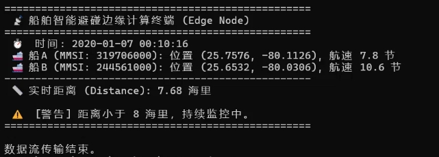
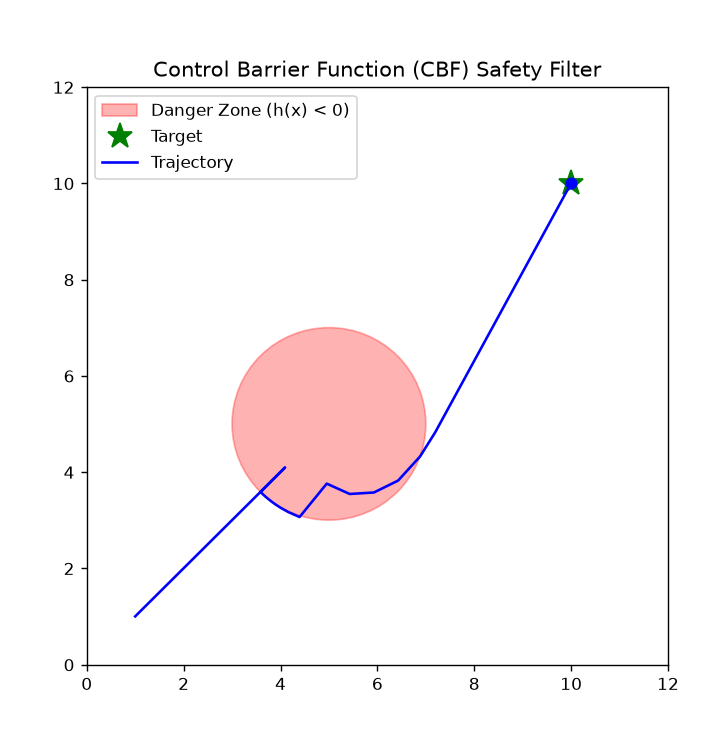
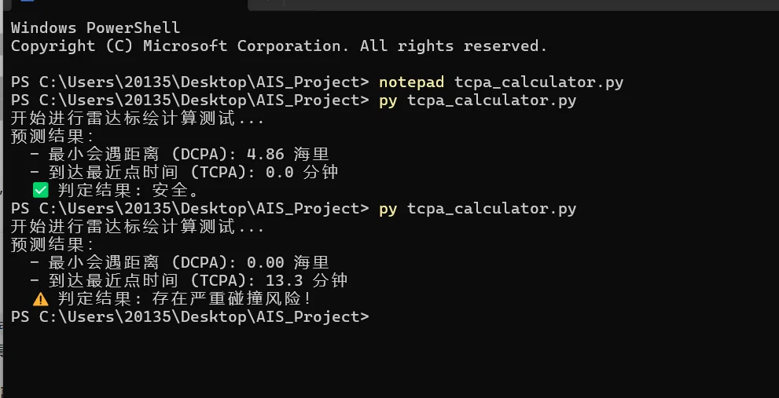

# AIS Maritime Collision Risk Analysis & Edge Computing Prototype

## Overview
This project is a prototype for **Smart Ocean Networks**, focusing on processing real Automatic Identification System (AIS) data to evaluate vessel collision risks, integrating Control Barrier Functions (CBF) for safety control, and simulating real-time edge computing for maritime IoT.

## Project Showcase

<p align="center">
  
  
  
</p>

## Key Features
1.Data Processing & Visualization: Uses Python (Pandas, Folium) to clean 300,000+ real AIS records (filtering out stationary vessels with SOG < 5 knots) and generates interactive maps ordered by timestamp.
2.DCPA Collision Risk Detection: Historical Encounter Detection: Uses synchronized AIS observations and Haversine distance to identify close vessel encounters from historical AIS trajectories. (Distance to Closest Point of Approach) between moving vessels, successfully identifying a close encounter (DCPA: 7.23 nm) between two real vessels.
3.CBF-based Safety Control (CBF_Demo): Implements a CBF-QP safety filter to demonstrate how a vessel automatically corrects its nominal path to avoid a danger zone, ensuring mathematical safety.
4.Edge Node Real-time Simulation:** Simulates how a shipboard terminal sequentially processes real-time AIS data, triggers on-the-fly warnings, and predicts TCPA (Time to Closest Point of Approach) using vector-based radar plotting logic.

## Module Details

### Part 1: AIS Data Processing & DCPA Calculation
The algorithm cleans 300,000+ historical records and uses the Haversine formula to compute DCPA, identifying specific historical encounters.(See `collision_risk.html` for the generated map).

### Part 2: CBF-based Safety Control (`CBF_Demo/`)
To address detected collision risks, I implemented a Control Barrier Function (CBF-QP) safety filter. The simulation demonstrates a vessel (blue trajectory) correcting its path to avoid a danger zone (red circle). More mathematical details can be found in `CBF_Demo/README.md`.

### Part 3: IoT Real-time Stream Simulation (`src/iot_stream_sim.py`)
Simulates an Edge Node receiving AIS data sequentially via VHF. The script calculates dynamic distances on the fly and triggers warnings when the distance falls below the safety threshold (8 nm), Edge-oriented AIS Stream Processing Simulation.（The current implementation replays historical AIS records sequentially to emulate online processing. It does not yet model a real communication network or physical edge device.）

### Part 4: TCPA Calculation & Radar Plotting (`src/tcpa_calculator.py`)
Beyond DCPA, I implemented the standard Maritime Radar Plotting algorithm. By decomposing SOG and COG into relative velocity vectors, the system predicts the TCPA in real-time. (If vessels are on a collision course, it predicts DCPA of 0.00 nm and triggers a severe warning).

## How to Run

1. Install the required dependencies:
   ```bash
   pip install -r requirements.txt
2.Download the AIS dataset (e.g., data7.csv) and place it in the root directory of the project.
3.Run the modules in the following order:
# 1. DCPA Collision Risk Detection
python src/test_ais.py

# 2. Radar Plotting & TCPA Calculation
python src/tcpa_calculator.py

# 3. IoT Edge Node Real-time Simulation
python src/iot_stream_sim.py

# 4. CBF Safety Filter Animation
python CBF_Demo/cbf_demo.py

##Future Work
1.Upgrade the CBF model to account for vessel inertia and implement High-Order CBF (HOCBF).
2.Integrate COLREGs (maritime collision rules) into the CBF-QP safety constraints.
3.Deploy the CBF-QP algorithm on embedded edge nodes and evaluate robustness under AIS communication delays.
