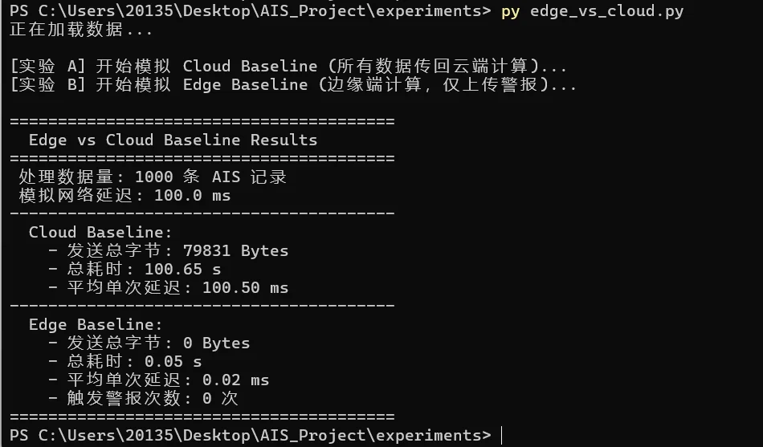
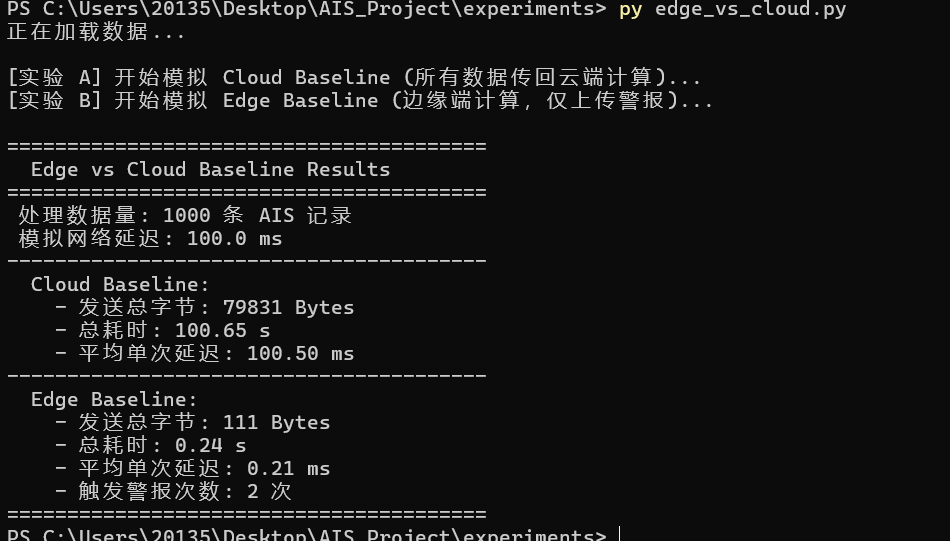

# AIS-Based Maritime Edge Computing for Real-Time Vessel Collision Risk Assessment

## Research Question
Can lightweight AIS-based vessel collision-risk assessment be performed at maritime edge nodes to reduce communication overhead and warning latency under bandwidth-constrained maritime networks?

## Project Showcase

<p align="center">
  
  
  
</p>

## System Architecture

```
Maritime IoT Scenario
        │
        ▼
AIS Data Stream (Historical Replay)
        │
        ▼
Shipboard / Near-shore Edge Node
        │
        ▼
Real-time Risk Assessment
(Vector-based DCPA / TCPA)
        │
        ▼
Local Risk Decision
        │
        ├── Safe ──→ Continue Monitoring
        │
        └── Risk ──→ Generate Local Alert
                           │
                           ▼
                 Optional Control Interface
                   (CBF Proof of Concept)
```
(Note: This project is a prototype for Smart Ocean Networks, focusing on processing real AIS data to evaluate vessel collision risks and simulate edge-side processing.)

## Features & Modules

### Part 1: Historical Encounter Detection & Visualization (src/test_ais.py)
Uses Python (Pandas) to clean 300,000+ AIS records (filtering stationary vessels).
Generates interactive maps using Folium.
Scientific Note: This module calculates the Observed Minimum Separation from historical AIS trajectories, not the predictive DCPA. It synchronizes historical timestamps to identify past close encounters.

### Part 2: Predictive DCPA/TCPA & Radar Plotting (src/tcpa_calculator.py)
Implements the standard Maritime Radar Plotting algorithm.
Uses relative-motion vectors derived from SOG and COG to predict the true DCPA (Distance at Closest Point of Approach) and TCPA (Time to Closest Point of Approach).

### Part 3: Edge-oriented AIS Stream Simulation (src/iot_stream_sim.py)
Simulates an Edge Node receiving AIS data sequentially via replay.
Triggers local warnings dynamically based on predicted DCPA/TCPA.
Scientific Note: The current implementation replays historical records to emulate online processing. It does not yet model a real physical network (e.g., MQTT, network delay).
Threshold Note: The safety thresholds (e.g., 8nm, 1nm, 20min) used in the simulation are configurable experimental thresholds for the prototype stage, not regulatory maritime standards.

### Part 4: CBF Safety Control Proof-of-Concept (CBF_Demo/)
Demonstrates a Control Barrier Function (CBF-QP) safety filter for a 2D point-mass model.
Shows how a vessel automatically corrects its path to avoid a static obstacle. (See CBF_Demo/README.md for mathematical details).

## How to Run

1. Install the required dependencies:

   ```bash
   pip install -r requirements.txt
2. Download the AIS dataset (data7.csv) and place it in the project root directory.
3. Run the modules:
python src/test_ais.py
python src/tcpa_calculator.py
python src/iot_stream_sim.py
python CBF_Demo/cbf_demo.py

## Future Work
1. Edge vs. Cloud Baseline:
Compare edge-side and cloud-side AIS risk assessment in terms of:
 communication overhead;
 processing latency;
 end-to-end warning latency; 
 transmitted data volume.
2. Simulated Maritime Network Conditions: Evaluate the system under different synthetic network latency and bandwidth conditions.
3. MQTT-Based Maritime IoT Messaging: Extend the current AIS replay prototype using a publish/subscribe architecture for vessel-edge-shore communication.
4. Vessel-Edge-Cloud Collaborative Computing: Explore how maritime sensing and risk-assessment tasks can be distributed among vessels, near-shore edge nodes, and cloud servers.
5. Safety-Control Integration: Further integrate risk assessment with vessel dynamics, CBF-based safety control, and COLREGs-aware maneuvering.

### Edge vs. Cloud Baseline Comparison
To validate the necessity of edge computing, I simulated a 100ms maritime network latency and compared the communication overhead and end-to-end latency between Cloud processing and Edge processing.

#### 1. Normal Scenario (No Alerts Triggered)
Under normal navigation, the Edge node processes all AIS data locally without transmitting raw data, resulting in **zero network bandwidth consumption**.


*Figure 5a: Edge processing avoids unnecessary data transmission when vessels are safe.*

#### 2. Risk Scenario (Alerts Triggered)
When the threshold is exceeded, the Edge node only transmits lightweight alert messages instead of raw data. This significantly reduces bandwidth overhead while maintaining near-zero warning latency.


*Figure 5b: Under the current synthetic network-delay setting, local edge processing reduces the modeled warning latency by avoiding the uplink delay required by the cloud baseline, and significantly reduces application-layer payload size..*
